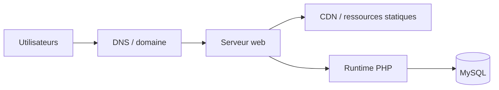

# Diagramme de déploiement

## Remarque

Le diagramme représente une architecture cible usuelle et de simplicité raisonnable. Il ne doit pas être interprété comme une preuve d’existence dans le dépôt.
